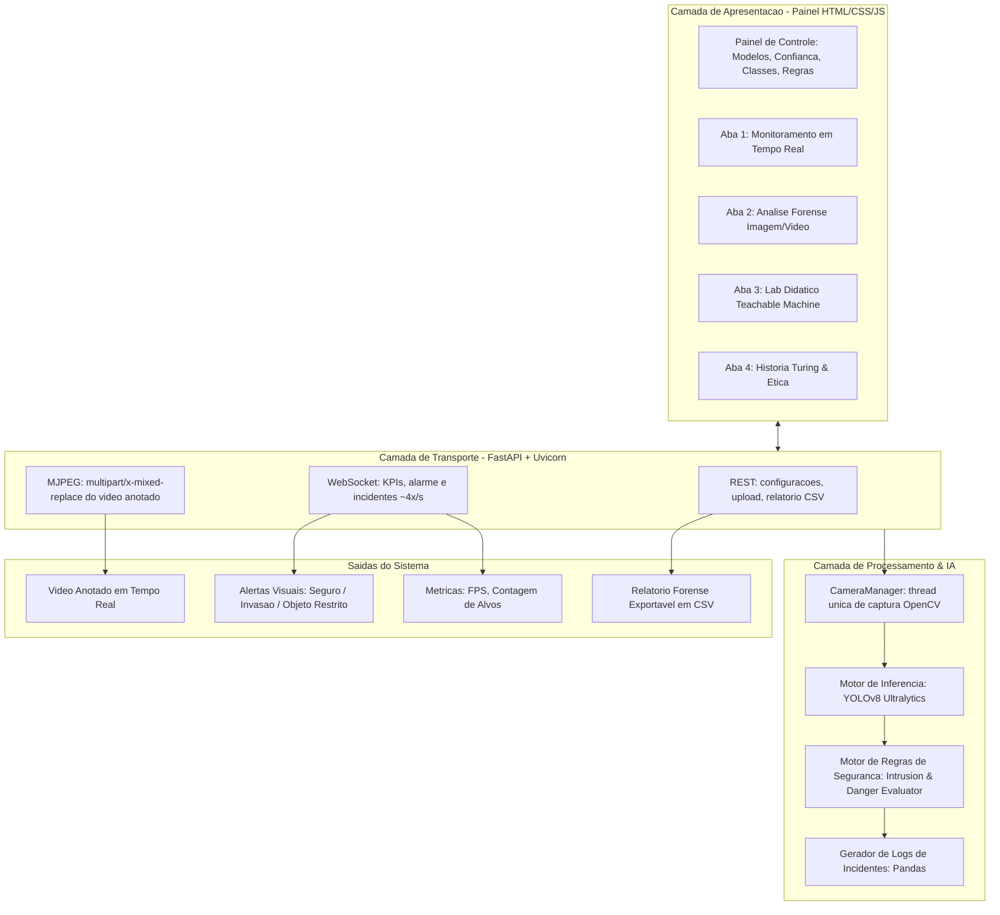

# 🛡️ SPEC TÉCNICA E FUNCIONAL: SpottingAI

> **Projeto:** Sistema Interativo de Visão Computacional Aplicada à Segurança Física e Patrimonial  
> **Contexto:** Trabalho Acadêmico de IA & Palestra Interativa (40 Minutos)  
> **Tema Central:** *"Do Enigma de Alan Turing à Visão Computacional em Tempo Real: Como a IA Transforma a Segurança"*  
> **Versão:** 1.0.0  
> **Autor(es):** Grupo de Inteligência Artificial  

---

## 📑 Sumário
1. [Visão Geral e Contexto](#1-visão-geral-e-contexto)
2. [Objetivos do Projeto](#2-objetivos-do-projeto)
3. [Arquitetura do Sistema](#3-arquitetura-do-sistema)
4. [Requisitos do Sistema](#4-requisitos-do-sistema)
   - 4.1 [Requisitos Funcionais (RF)](#41-requisitos-funcionais-rf)
   - 4.2 [Requisitos Não-Funcionais (RNF)](#42-requisitos-não-funcionais-rnf)
5. [Módulos do Aplicativo (Painel Web)](#5-módulos-do-aplicativo-painel-web)
   - 5.1 [Painel de Controle Lateral (Parâmetros)](#51-painel-de-controle-lateral-parâmetros)
   - 5.2 [Módulo 1: Monitoramento em Tempo Real (Webcam)](#52-módulo-1-monitoramento-em-tempo-real-webcam)
   - 5.3 [Módulo 2: Análise Forense de Mídia (Upload)](#53-módulo-2-análise-forense-de-mídia-upload)
   - 5.4 [Módulo 3: Laboratório Teachable Machine vs YOLO](#54-módulo-3-laboratório-teachable-machine-vs-yolo)
   - 5.5 [Módulo 4: Linha do Tempo Turing, Ética & Ataques Adversariais](#55-módulo-4-linha-do-tempo-turing-ética--ataques-adversariais)
6. [Roteiro Detalhado da Apresentação (40 Minutos)](#6-roteiro-detalhado-da-apresentação-40-minutos)
7. [Estrutura de Arquivos do Projeto](#7-estrutura-de-arquivos-do-projeto)
8. [Stack Tecnológica e Dependências](#8-stack-tecnológica-e-dependências)
9. [Guia de Instalação e Execução](#9-guia-de-instalação-e-execução)

---

## 1. Visão Geral e Contexto

O projeto **SpottingAI** consiste em uma aplicação visual, modular e interativa que demonstra na prática o funcionamento de algoritmos de Visão Computacional voltados à segurança. 

O projeto faz uma ponte histórica entre a **segurança computacional clássica** (iniciada por **Alan Turing** na quebra da máquina *Enigma* durante a Segunda Guerra Mundial) e a **segurança inteligente moderna**, baseada em Redes Neurais Convolucionais profundas (CNNs) e modelos em tempo real como o **YOLOv8**.

---

## 2. Objetivos do Projeto

* **Demonstração Prática:** Permitir que o público visualize caixas delimitadoras (*bounding boxes*), classes detectadas e níveis de confiança estatística em tempo real.
* **Simulação de Regras de Segurança:** Identificar violações de perímetro, aglomerações e presença de objetos não autorizados/perigosos.
* **Didática Acessível:** Explicar a diferença conceitual entre **Classificação de Imagens** (demonstrada via *Google Teachable Machine*) e **Detecção/Localização de Objetos** (YOLO).
* **Interatividade com o Público:** Criar momentos de participação da plateia durante os 40 minutos de palestra para evitar monotonia.

---

## 3. Arquitetura do Sistema

O sistema é dividido em três camadas. A **camada de apresentação** é um painel HTML/CSS/JS
estático servido por **FastAPI**; a **camada de processamento** roda em Python puro e não
conhece a interface; a comunicação entre elas usa três canais distintos, cada um adequado ao
tipo de dado que transporta.



### 3.1 Decisões de arquitetura

* **Núcleo desacoplado da interface.** `detector.py`, `rules.py` e `logger.py` não importam
  nem FastAPI nem qualquer biblioteca de UI. São testáveis isoladamente e sobreviveram sem
  uma linha alterada à substituição da camada de apresentação (Streamlit → HTML).
* **Uma única thread de captura.** O `CameraManager` abre a webcam uma vez e mantém em
  memória o último quadro anotado. Abrir uma segunda aba do navegador **não** abre uma
  segunda câmera, e a taxa de captura independe do número de clientes conectados.
* **Três canais, três naturezas.** Vídeo contínuo vai por MJPEG (sem re-render de página);
  métricas e alarmes vão por WebSocket (baixa latência, sem *polling*); operações pontuais
  vão por REST.
* **Análise de vídeo assíncrona.** Um upload `.mp4` devolve um `job_id` imediatamente e o
  processamento corre em segundo plano, com progresso consultável — a requisição HTTP não
  fica pendurada.
* **Zero dependência externa no navegador.** Nenhum CDN, nenhuma biblioteca de terceiros no
  frontend. O gráfico de distribuição é desenhado em CSS puro. A aplicação funciona sem
  qualquer acesso à internet (RNF03).

---

## 4. Requisitos do Sistema

### 4.1 Requisitos Funcionais (RF)
* **[RF01] Detecção em Tempo Real:** O sistema deve processar streams de vídeo da webcam e identificar objetos da lista de classes pré-treinadas da COCO dataset.
* **[RF02] Ajuste Dinâmico de Confiança:** O usuário/apresentador deve conseguir alterar o nível mínimo de certeza ($0\% \text{ a } 100\%$) através de um slider em tempo de execução.
* **[RF03] Filtro de Classes Críticas:** O sistema deve permitir isolar classes de interesse de segurança:
  * `person` (vigilância perimetral e contagem de ocupação)
  * `backpack`, `handbag`, `suitcase` (bagagens suspeitas/abandonadas)
  * `cell phone`, `laptop` (dispositivos eletrônicos em salas seguras/exames)
  * `knife`, `scissors` (objetos cortantes/potencial ameaça)
  * `car`, `motorcycle`, `bus`, `truck` (controle de acesso de veículos)
* **[RF04] Disparador de Alertas Visuais:** O sistema deve alterar visualmente seu banner de estado para `🔴 ALERTA DE INVASÃO / AMEAÇA` quando uma regra configurada for violada (ex: mais de $N$ pessoas na área ou objeto perigoso detectado).
* **[RF05] Inspeção Forense Estática:** O sistema deve permitir o upload de fotos ou vídeos para análise quadro a quadro e contagem agregada de alvos.
* **[RF06] Exportação de Logs:** O sistema deve registrar eventos críticos com *timestamp*, classe, nível de confiança e permitir o download em formato `.csv`.
* **[RF07] Módulo Didático Comparativo:** Exibir tabela interativa demonstrando as diferenças entre modelos baseados em nuvem/navegador (Teachable Machine) vs modelos locais industriais (YOLO).

### 4.2 Requisitos Não-Funcionais (RNF)
* **[RNF01] Desempenho e Latência:** O processamento com o modelo `yolov8n.pt` (Nano) deve manter taxa de quadros aceitável em CPU convencional ($\ge 15$ FPS) sem necessidade obrigatória de GPU dedicada.
* **[RNF02] Usabilidade:** Interface limpa, responsiva, em tema escuro profissional (*Dark Security Mode*), com tipografia de alta legibilidade para projeção em telão/datashow.
* **[RNF03] Portabilidade:** Código autocontido, compatível com Windows 10/11, com inicializador `.bat` em um único clique.
* **[RNF04] Confiabilidade:** Tratamento robusto de exceções para evitar travamentos da aplicação caso a webcam não esteja conectada ou o formato do arquivo de upload seja inválido.

---

## 5. Módulos do Aplicativo (Painel Web)

### 5.1 Painel de Controle Lateral (Parâmetros)
* Seletor de Modelo: `yolov8n.pt` (rápido/leve) ou `yolov8s.pt` (maior precisão).
* Slider de Confiança de Detecção ($10\%$ a $95\%$).
* Multiselect de Classes de Segurança ativas.
* Seletor de Regras de Alarme:
  * Limite máximo de pessoas no perímetro ($X$ pessoas).
  * Flag de alerta para objetos cortantes/perigosos.
  * Flag de alerta para dispositivos em sala restrita.

### 5.2 Módulo 1: Monitoramento em Tempo Real (Webcam)
* Dois modos de captura: **ao vivo via OpenCV** no servidor (principal) e **snapshot pela
  câmera do navegador** (alternativo, para quando o acesso direto à webcam falhar).
* **Seleção de dispositivo:** lista as câmeras pelo nome real do sistema, com a resolução
  máxima de cada uma, e permite re-varredura para reconhecer uma câmera de celular conectada
  após a inicialização. O backend de captura (Media Foundation ou DirectShow) é escolhido
  automaticamente, aceitando o primeiro que efetivamente entregue imagem.
* Renderização do feed de vídeo com caixas coloridas por tipo de objeto.
* Painel de KPIs:
  * **FPS em Tempo Real**
  * **Total de Pessoas Detectadas**
  * **Status de Segurança** (🟢 SEGURO / 🔴 ALERTA ATIVO)
* Tabela de histórico de incidentes recentes atualizada dinamicamente.

### 5.3 Módulo 2: Análise Forense de Mídia (Upload)
* Suporte para arquivos `.jpg`, `.png`, `.mp4`.
* Divisão visual em colunas: **Mídia Original** vs **Mídia Periciada por IA**.
* Gráfico de barras com distribuição de objetos encontrados.
* Botão de download: `📥 Baixar Relatório Forense (CSV)`.

### 5.4 Módulo 3: Laboratório Teachable Machine vs YOLO
* Painel explicativo dividindo os conceitos:
  * *Classificação de Imagem:* "Esta imagem inteira contém uma pessoa?" (Sim/Não).
  * *Detecção de Objetos:* "Onde estão todas as pessoas e objetos nesta imagem, e quais suas coordenadas?"
* Guia de execução da dinâmica ao vivo com a plateia usando o Teachable Machine.
* Link direto para a ferramenta do Google.

### 5.5 Módulo 4: Linha do Tempo Turing, Ética & Ataques Adversariais
* Card Histórico: A máquina *Bombe* de Bletchley Park e o nascimento da segurança computacional.
* Card Ética & Desafios:
  * Vieses algorítmicos e falsos positivos em vigilância pública.
  * Privacidade e LGPD / regulamentações de IA.
  * *Adversarial Attacks* (padrões de roupas que enganam redes neurais).

---

## 6. Roteiro Detalhado da Apresentação (40 Minutos)

| Bloco | Tempo | Tema Central | Atividade / Dinâmica |
| :--- | :--- | :--- | :--- |
| **1. Abertura & Gancho** | 00:00 - 07:00 | **O Legado de Turing** | Mostrar o salto histórico: da quebra da Enigma por Turing à Visão Computacional moderna. Pergunta para a plateia. |
| **2. Desmistificação** | 07:00 - 17:00 | **Teachable Machine ao Vivo** | Treinar um classificador ao vivo em 3 minutos (ex: "Acesso Autorizado via Crachá" vs "Acesso Negado"). Chamar 1 voluntário. |
| **3. Demonstração Central** | 17:00 - 30:00 | **O App SpottingAI (YOLOv8)** | Abrir o App. Mostrar detecção de pessoas na plateia pela webcam, simular alarme de invasão e fazer upload de cena de segurança forense. |
| **4. O Lado B da IA** | 30:00 - 35:00 | **Ética, Falhas & Ataques** | Discutir falsos positivos, ataques de ilusão adversarial (camuflagens para IA) e dilemas éticos de vigilância. |
| **5. Fechamento & Q&A** | 35:00 - 40:00 | **Conclusão & Perguntas** | Recapitulação final, agradecimentos e abertura para perguntas da banca/professores. |

---

## 7. Estrutura de Arquivos do Projeto

```text
spotting_ai/
│
├── SPEC.md                     # Esta especificação técnica completa
├── README.md                   # Manual de uso, setup e roteiro resumido
├── requirements.txt            # Dependências Python
├── run.bat                     # Inicializador automático para Windows
│
├── app.py                      # Servidor FastAPI: rotas REST, MJPEG e WebSocket
│
├── src/                        # Núcleo — independente da camada de apresentação
│   ├── __init__.py
│   ├── detector.py             # Inferência YOLOv8 e anotação visual por categoria
│   ├── rules.py                # Motor de regras de alarme (puro, sem I/O)
│   ├── logger.py               # Histórico de incidentes e exportação CSV
│   └── camera.py               # Thread de captura da webcam e stream MJPEG
│
├── static/                     # Painel de operação (sem dependências externas)
│   ├── index.html              # Estrutura das 4 abas e conteúdo didático
│   ├── css/style.css           # Sistema visual (tema escuro, movimento, HUD)
│   ├── js/app.js               # Controles, WebSocket e renderização
│   └── js/ui.js                # Animações e micro-interações (não toca na API)
│
├── sample_media/
│   └── perimeter_test.jpg      # Imagem padrão para teste forense offline
│
└── legacy_streamlit/           # Arquivo morto da primeira versão (não é importado)
```

### 7.1 Rotas da API

| Método | Rota | Função |
| :--- | :--- | :--- |
| `GET` | `/` | Painel de operação |
| `GET` | `/api/config` | Modelos, taxonomia de classes e cores por categoria |
| `GET` `POST` | `/api/settings` | Lê e atualiza confiança, classes e regras de alarme |
| `GET` | `/api/state` | Estado da câmera, do modelo e total de incidentes |
| `GET` | `/api/cameras` | Câmeras detectadas, nomes e resoluções aceitas (`?refresh=true` re-varre) |
| `POST` | `/api/camera/start` · `/stop` | Liga e desliga o monitoramento |
| `GET` | `/video/stream` | Feed MJPEG anotado |
| `WS` | `/ws/events` | KPIs, alarme e incidentes em tempo real |
| `POST` | `/api/analyze/image` · `/snapshot` · `/video` | Perícia forense |
| `GET` | `/api/analyze/sample` | Perícia da imagem de exemplo |
| `GET` | `/api/jobs/{id}` | Progresso da análise de vídeo |
| `GET` `POST` | `/api/incidents` · `/clear` | Histórico de incidentes |
| `GET` | `/api/report.csv` | Relatório forense exportável |

---

## 8. Stack Tecnológica e Dependências

```text
fastapi>=0.110.0          # camada HTTP: rotas REST, MJPEG e WebSocket
uvicorn>=0.27.0           # servidor ASGI
python-multipart>=0.0.9   # upload de arquivos (perícia forense)
ultralytics>=8.1.0        # YOLOv8
opencv-python>=4.8.0      # captura de webcam, decodificação e anotação
pillow>=10.0.0
pandas>=2.0.0             # histórico de incidentes e exportação CSV
numpy>=1.24.0
```

O frontend **não tem dependências**: HTML, CSS e JavaScript puros, sem CDN e sem framework.
Isso é um requisito, não uma simplificação — o sistema precisa funcionar em uma sala sem
internet (RNF03).

---

## 9. Guia de Instalação e Execução

### Passo 1: Clonar/Navegar para a pasta do projeto
```powershell
cd spotting_ai
```

### Passo 2: Criar e ativar ambiente virtual (Recomendado)
```powershell
python -m venv venv
.\venv\Scripts\Activate.ps1
```

### Passo 3: Instalar as dependências
```powershell
pip install -r requirements.txt
```

### Passo 4: Executar a aplicação
```powershell
python app.py
```
O painel fica disponível em **http://localhost:8000**.

*(Ou dê um duplo clique no arquivo `run.bat` no Windows, que faz os passos 2 a 4 e ainda
abre o navegador automaticamente.)*

> **Primeira execução:** a Ultralytics baixa os pesos do modelo (`yolov8n.pt`, ~6 MB)
> automaticamente. Isso exige internet **uma única vez**; depois o sistema roda offline.
